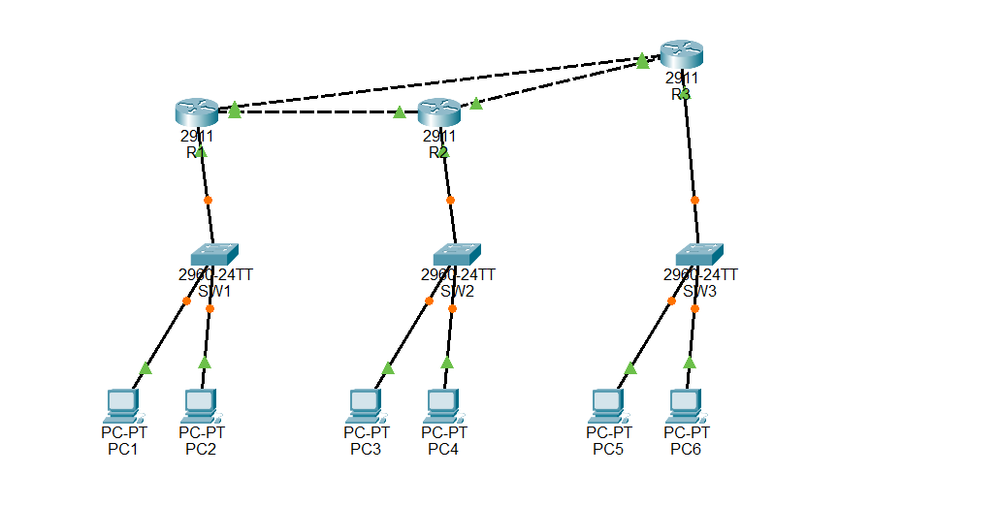

# Packet Tracer routing and resilience labs

Three real Cisco Packet Tracer 9.0.1 projects were built and tested on 12 October 2026. The user requested static routing, RIPv2, and OSPF coverage. All projects are saved with the fault link restored.

| Project | Routing | Observed behavior with R1–R2 disabled |
| --- | --- | --- |
| [FaultNet-static.pkt](static/FaultNet-static.pkt) | Static | PC1–PC3 fails (0/4); restoration returns to 4/4. |
| [FaultNet-rip.pkt](rip/FaultNet-rip.pkt) | RIPv2, no auto-summary | PC1–PC3 reachable via R3 (4/4). |
| [FaultNet-ospf.pkt](ospf/FaultNet-ospf.pkt) | OSPF process 1, area 0 | First post-fault ping 3/4, then 4/4 via R3. |

Each directory includes a .pkt, topology.png preview, validated plan.json, build.js, six IOS configurations, manifest.json, and measure-evidence.json. [LIVE-VERIFICATION.md](LIVE-VERIFICATION.md) preserves the observed transient results and route-table evidence.

## Topology and addresses

The same network is used for all protocols: three Cisco 2911 routers in a triangle, three Cisco 2960-24TT switches, six PCs, and 12 links. Packet Tracer also adds an auxiliary Power Distribution Device0; the raw live device count is therefore 13. The third router provides an alternate path.

| Segment | Network / endpoints |
| --- | --- |
| LAN 1 / R1 | 192.168.0.0/24; gateway .1; PC1 .2, PC2 .3 |
| LAN 2 / R2 | 192.168.1.0/24; gateway .1; PC3 .2, PC4 .3 |
| LAN 3 / R3 | 192.168.2.0/24; gateway .1; PC5 .2, PC6 .3 |
| R1 G0/0 – R2 G0/0 | 10.0.0.0/30; R1 .1, R2 .2 |
| R2 G0/1 – R3 G0/0 | 10.0.0.4/30; R2 .5, R3 .6 |
| R3 G0/1 – R1 G0/1 | 10.0.0.8/30; R3 .9, R1 .10 |

Previews show the canvas after reopening. Switch indicators can show startup STP convergence; screenshots do not replace the measured ping results. Canvas positions were adjusted for clearer links and labels after the network tests, without changing routing or addresses.

## Repeat the live test

1. Open one .pkt in Packet Tracer 9.0.1. Wait for interfaces and routing to converge.
2. From PC1's Desktop > Command Prompt, run ping 192.168.1.2. Repeat if initial ARP or routing startup consumes replies; record every result.
3. On R1, enter enable, configure terminal, interface GigabitEthernet0/0, shutdown, then end.
4. Ping from PC1 again. Static routing should fail. RIPv2/OSPF should reconverge through R3; allow time and retain transient failures.
5. On R1, use show ip route to inspect the destination LAN. For dynamic failover, 192.168.1.0/24 should use 10.0.0.9 on GigabitEthernet0/1.
6. Restore R1 GigabitEthernet0/0 with no shutdown. Confirm PC1–PC3 replies again. Keep the saved baseline files intact by saving reruns to a separate directory.

The recorded baseline/fault/restoration tests used the MCP's live port-power setter, which Packet Tracer reflected as an administrative interface shutdown.

## Optional build helpers

Opening the completed .pkt files requires no Python or MCP. Rebuilding uses the separately supplied MCP-Packet-Tracer source and its Python dependencies; it is not a Node application dependency.

Set FAULTNET_PACKET_TRACER_MCP to that checkout. The default source location is the current user's Downloads/MCP-Packet-Tracer-main. From this directory:

~~~powershell
$env:FAULTNET_PACKET_TRACER_MCP = 'C:\path\to\MCP-Packet-Tracer-main'
python regenerate.py
python run_packet_tracer.py static check
python run_packet_tracer.py static deploy
python run_packet_tracer.py static measure
~~~

Use a fresh empty Packet Tracer workspace before each deploy, with the V5 MCP Builder extension running. Replace static with rip or ospf for the other protocols. Regeneration writes plans/configurations to ignored results/generated, configurable through FAULTNET_PACKET_TRACER_OUTPUT; it does not update the saved .pkt or live evidence. The runner consumes the committed plan/build inputs and writes new projects/screenshots/observations to ignored results/<UTC timestamp>/<scenario>, configurable with --output-dir. It accepts the simulator's auxiliary power device when checking inventory.

These helpers were syntax/import checked and the generator outputs were validated. The completed projects were built/tested with the MCP tools; the adjusted standalone runner has not been rerun through the complete live deployment/measurement cycle.

## Evidence boundaries

FaultNet's dashboard measures synthetic HTTP outcomes, whole-response elapsed time, goodput, and recovery. Packet Tracer tests simulated IP reachability/routing. Wireshark captures and verification on other laptops remain separate pending tasks. Do not combine the observations into an IP packet-loss or RTT claim for the application.
